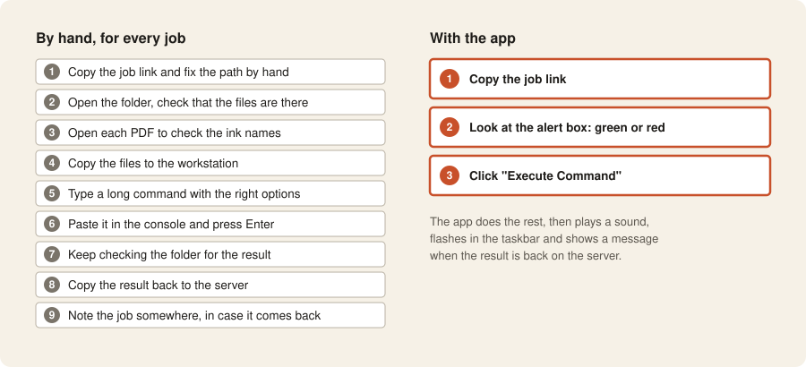
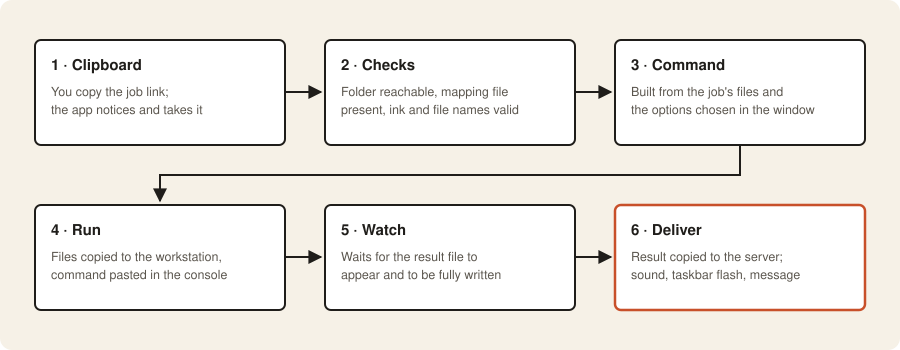
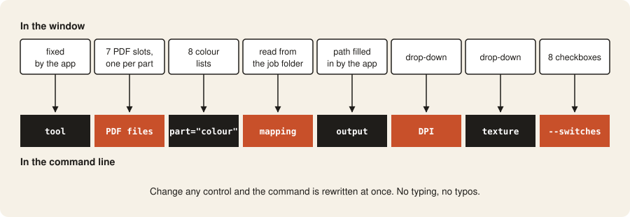

# Board for Batch Command

A Windows desktop app (C#, WinForms, .NET Core 3.1) that I designed and built on my own initiative
at INDG, where I worked as an artwork specialist in a 3D product-visualisation pipeline.

> **This was an experiment.** I had no solid knowledge of C# when I started. I used what I knew from
> JavaScript and looked up a great many things on Stack Overflow.
>
> My quality standard at the time was simple: *if the app works, it is a good app.* By that standard
> this one is excellent. By any other standard, please read the section
> [An honest look at the code](#an-honest-look-at-the-code) before opening `Form1.cs`.

**Nobody asked for it.** I wrote it to speed up my own work, and it became the daily tool of the
whole artwork team for years.

## The problem

Every job meant the same sequence, dozens of times a day: copy the artwork PDFs and their JSON
description from the server to the workstation, compose a long command line for the rendering tool
with the right options for that product, run it, wait for the PNG output to appear, check it and copy
the results back to the server. Each step was manual and easy to get wrong, and everyone on the team
did it the same way. I was the first to automate it.

## How a job flows through the app

## What the app does, step by step

### 1. It picks up the job from the clipboard

1. Watches the clipboard all the time. Copying a job link is enough; there is nothing to paste.
2. Recognises the different forms a job address can have: a link from the ticketing system, a
   `file://` link, a network path, a local working folder.
3. Reads the ticket number out of a ticket link and shows it.
4. Cleans the path: turns web-style links into Windows paths, replaces `%20` with spaces, fixes the
   slashes, adds the missing final backslash, and corrects the path if it was copied one folder too deep.
5. Puts the cleaned path back on the clipboard, ready to be pasted anywhere else.

### 2. It checks the job before any work is done

6. Checks that the folder can be reached. If not, it says the VPN or the connection is probably down.
7. Checks that the mapping file (JSON) is there.
8. Lists the PDF and JSON files of the job.
9. Opens every PDF and reads the names of its printing inks from the file's metadata.
10. Raises an alert when an ink is named like a standard process colour, or when an ink name or a file
    name contains accented letters.
11. Shows one alert box: **green "ok"** or **red with the list of problems**. The designer knows in
    one glance, before the render is started.

### 3. It builds the command

12. Reads the mapping file and fills the drop-downs with the parts of that product (front, back,
    cap, neck, body…) and the colours available for the body and for the liquid.
13. Lets you assign each PDF to a part, up to seven PDFs.
14. Adds the chosen colours for up to four body parts and four liquids.
15. Adds the resolution (DPI) and the texture size.
16. Adds any of eight switches (cache options, tiled processing, PSD metadata, overrides, text output).
17. Fills in the mapping file, the output file and the temporary folder by itself.
18. Converts Windows paths into the format the rendering tool expects.
19. Rewrites the command instantly whenever a control changes.
20. Saves the command as a text file inside the job, so anyone can see later how it was rendered.

### 4. It runs the job and delivers the result

21. Copies the JSON and PDF files from the server to the workstation.
22. If an older result exists, keeps it as a numbered copy instead of overwriting it.
23. Brings the console window to the front, pastes the command and presses Enter.
24. Watches the output folder until the new PNG appears.
25. Waits until the result files are completely written, checking again every two seconds.
26. Copies the result back to the server, with the text output and, if requested, the temporary folder.
    If the copy fails, it tries again.
27. Flashes in the taskbar, plays a sound and shows a message on top of everything, so nobody has to
    sit and watch a folder.

### 5. The extras that grew around it

28. **History**: every job path is stored with its date; back / forward buttons move between the jobs
    of the day, and a search box finds older ones.
29. **Shortcuts**: open the job folder in Explorer, open the JSON, open any of the PDFs, open the job
    in 3ds Max, start an Illustrator script that prepares masks.
30. **Rename the artwork** output before it is produced.
31. **Remove** the PDFs or JSON files that are not needed from the list.
32. **Always on top** toggle for the window.
33. **Second tool, same idea**: a tab that builds the command for the batch uploader from the Excel
    file found in a folder, with optional extra parameters, and runs it in PowerShell.
34. **Find PDFs**: searches the archive in the background for a list of file names and copies the
    ones it finds into the job.
35. **Excel helper**: composes the header and the row for the upload spreadsheet (inputs, ink names,
    IDs) and puts them on the clipboard, ready to paste into Excel.

## An honest look at the code

I knew JavaScript from scripting Adobe applications. I learned C# for this app from the .NET
documentation and Stack Overflow, in 2021–2022, before AI coding assistants. The code shows it:

- It is **one form with 3,340 lines**. Separation of concerns was a concern I had not met yet.
- Variable names come in two languages, sometimes in the same line.
- The app runs the command by bringing the console to the front, pasting and pressing Enter, exactly
  like a person would. It is not elegant. It is, however, exactly what I used to do by hand, minus me.
- There are 19 short pauses (`Thread.Sleep`) in the code. I am fairly sure most of them are load-bearing.
- The project is still called `WinFormsApp1`, the name Visual Studio gave it on the first day.

It is not how I would structure it today. But it did what software is for: it ran every working day,
people relied on it, and it saved the team hours every week. The lesson I kept is the useful half of
my old standard: working software in people's hands first, then make it clean.

## Stack

C# · Windows Forms · .NET Core 3.1 · Newtonsoft.Json · PdfPig · PDFsharp · XmpCore · SharpClipboard · Serilog

## Build

Open `WinFormsApp1.sln` in Visual Studio 2019 or later and build. The working folders and server
paths are fixed in the code for the environment it was written for, so the app builds anywhere but is
only useful there.

© Dan Ichimescu
